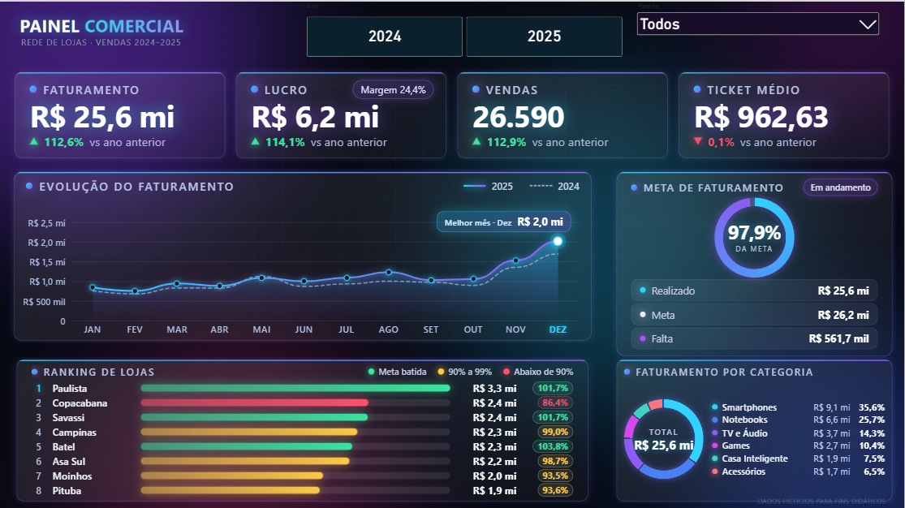
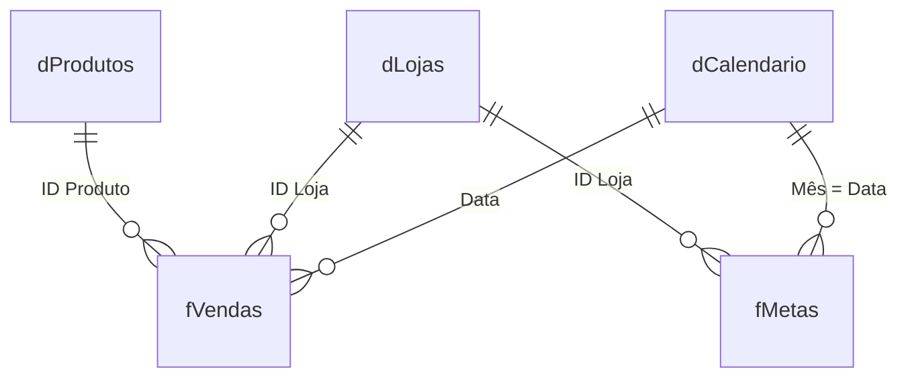

# 📊 Painel Comercial — Rede de Lojas de Eletrônicos

> Dashboard em **Power BI** com modelo dimensional, medidas em **DAX** e visuais desenhados com **HTML + CSS + SVG** (visual *HTML Content*), em tema escuro, painéis com efeito de vidro e detalhes em neon azul e roxo.

> ⚠️ **Todos os dados são fictícios**, criados apenas para fins didáticos.



---

## Sumário

1. [Sobre o projeto](#1-sobre-o-projeto)
2. [Visão geral do painel](#2-visão-geral-do-painel)
3. [Ferramentas](#3-ferramentas)
4. [Modelo de dados](#4-modelo-de-dados)
5. [Passo a passo do desenvolvimento](#5-passo-a-passo-do-desenvolvimento)
6. [Medidas DAX](#6-medidas-dax)
7. [Como os visuais em HTML funcionam](#7-como-os-visuais-em-html-funcionam)
8. [Regras de cada visual](#8-regras-de-cada-visual)
9. [Desafios e aprendizados](#9-desafios-e-aprendizados)
10. [Limitações conhecidas](#10-limitações-conhecidas)
11. [Como abrir o projeto](#11-como-abrir-o-projeto)
12. [Estrutura do repositório](#12-estrutura-do-repositório)
13. [Autor](#13-autor)

---

## 1. Sobre o projeto

Painel de vendas de uma rede de lojas de eletrônicos, cobrindo **janeiro/2024 a dezembro/2025**, para acompanhar faturamento, lucro, ticket médio, atingimento de metas, desempenho por loja e mix de categorias.

**Perguntas que o painel responde**

- Quanto faturamos e lucramos, e com qual margem? Crescemos em relação ao ano anterior?
- Como foi o ano mês a mês? Qual foi o melhor mês?
- Estamos batendo a meta? Quanto falta?
- Quais lojas lideram o faturamento e quais estão abaixo da meta?
- Quais categorias pesam mais no faturamento?

**Base de dados**

- 26.590 vendas (uma por linha, com `ID Venda` único)
- 12 lojas e 6 categorias de produto
- Metas mensais por loja
- Período: 01/01/2024 a 31/12/2025

---

## 2. Visão geral do painel

| Visual | O que mostra |
|---|---|
| **Cartões** (topo) | Faturamento, Lucro (com a margem), Vendas e Ticket Médio, cada um com a variação contra o ano anterior (seta verde se subiu, vermelha se caiu) |
| **Evolução do faturamento** | Linha mensal do ano selecionado, ano anterior tracejado, área em degradê e melhor mês destacado com o valor |
| **Meta de faturamento** | Anel de atingimento com realizado, meta e quanto falta (ou quanto superou) |
| **Ranking de lojas** | As 8 lojas que mais faturaram, em barras, com valor e % da meta. Verde = bateu a meta, amarelo = 90% a 99%, vermelho = abaixo de 90% |
| **Faturamento por categoria** | Rosca com o total no meio e legenda com valor e % de cada categoria |

Os visuais respondem aos filtros da página (ano, mês, loja e produto). A única exceção é a *Evolução*, que sempre mostra os 12 meses do ano escolhido.

---

## 3. Ferramentas

- **Power BI Desktop**: modelagem, medidas e relatório
- **DAX**: calendário, medidas e geração do HTML dos visuais
- **HTML Content** (visual do AppSource): exibe o HTML devolvido por uma medida
- **HTML, CSS e SVG**: desenho dos cartões, gráficos e animações, sem JavaScript
- **Claude (Anthropic)**, conectado ao Power BI Desktop pelo servidor MCP *Power BI Modeling*, como apoio para criar tabelas, relacionamentos e medidas diretamente no modelo e validar o resultado com consultas DAX

---

## 4. Modelo de dados

Modelo em estrela com duas tabelas fato e três dimensões.

| Tabela | Tipo | Papel |
|---|---|---|
| `fVendas` | Fato | Uma linha por venda: `ID Venda`, `Data`, `ID Produto`, `ID Loja`, `Quantidade`, `Preço Unitário`, `Valor Venda`, `Custo Venda` |
| `fMetas` | Fato | Meta mensal por loja: `ID Loja`, `Mês` (sempre o dia 1 do mês), `Meta` |
| `dProdutos` | Dimensão | Produtos e `Categoria` |
| `dLojas` | Dimensão | Lojas |
| `dCalendario` | Dimensão | Calendário criado em DAX, marcado como tabela de datas |
| `_Medidas` | Auxiliar | Tabela que guarda apenas as medidas |



Todos os relacionamentos são **muitos-para-um**, com filtro em **uma direção** (da dimensão para a fato).

---

## 5. Passo a passo do desenvolvimento

### Etapa 1 — Diagnóstico do modelo

Antes de criar qualquer coisa, conferi a qualidade da base:

- as datas de `fVendas` não têm hora nem valores vazios (intervalo de 01/01/2024 a 31/12/2025);
- as chaves de `dProdutos` e `dLojas` são únicas;
- não há vendas ou metas apontando para loja ou produto inexistente;
- todas as datas de `fMetas` caem no dia 1;
- `Valor Venda` e `Custo Venda` já são totais da venda (batem com quantidade × preço e quantidade × custo unitário);
- cada linha de `fVendas` tem um `ID Venda` diferente, então "quantidade de vendas" é a contagem de IDs.

### Etapa 2 — Tabela calendário

Criada em DAX, do primeiro ao último dia de `fVendas`, com `Data`, `Ano`, `Mês` (número) e `Nome Mês` (ordenado pelo número do mês), e marcada como **tabela de datas**.

### Etapa 3 — Relacionamentos

Cinco relacionamentos (ver diagrama acima). `fMetas[Mês]` se liga a `dCalendario[Data]`, o que funciona porque a meta é sempre registrada no dia 1 do mês.

### Etapa 4 — Tabela de medidas

Criei a tabela `_Medidas` (com a coluna auxiliar oculta) e **16 medidas**, organizadas em pastas de exibição:

- **Base:** Faturamento, Custo, Lucro, Margem %, Qtd Vendas, Ticket Médio
- **Metas:** Meta, % Meta
- **Ano Anterior:** versão "AA" e "Var %" de Faturamento, Lucro, Qtd Vendas e Ticket Médio

Formatos em R$ e %.

### Etapa 5 — Conferência dos números

Consulta DAX por ano para validar as medidas:

| Ano | Faturamento | Lucro | Meta | % Meta |
|---|---|---|---|---|
| 2024 | R$ 12.036.972,52 | R$ 2.919.301,26 | R$ 12.162.000,00 | 99,0% |
| 2025 | R$ 13.559.324,92 | R$ 3.329.900,74 | R$ 13.996.000,00 | 96,9% |

Os dois anos somam R$ 25.596.297,44, o mesmo total obtido somando `fVendas` diretamente: os relacionamentos não perdem nem duplicam vendas.

### Etapa 6 — Visuais em HTML

Criei **5 medidas** que devolvem HTML: `HTML Cartões`, `HTML Evolução`, `HTML Meta`, `HTML Ranking Lojas` e `HTML Categorias`. Cada uma é exibida por um visual *HTML Content*. A técnica está detalhada na [seção 7](#7-como-os-visuais-em-html-funcionam).

### Etapa 7 — Revisão de legibilidade

Na primeira versão, parte dos textos (eixos, legendas, títulos) ficou pequena demais. Os tamanhos de fonte eram calculados pela largura do visual e os quadros do painel eram mais estreitos do que o previsto. Refiz os tamanhos com base no formato real de cada quadro, clareei os textos secundários e dei mais peso aos textos pequenos.

---

## 6. Medidas DAX

**Calendário**

```dax
dCalendario =
VAR _Datas = CALENDAR ( MIN ( fVendas[Data] ), MAX ( fVendas[Data] ) )
RETURN
    SELECTCOLUMNS (
        _Datas,
        "Data", [Date],
        "Ano", YEAR ( [Date] ),
        "Mês", MONTH ( [Date] ),
        "Nome Mês",
            UPPER ( LEFT ( FORMAT ( [Date], "mmmm", "pt-BR" ), 1 ) )
                & MID ( FORMAT ( [Date], "mmmm", "pt-BR" ), 2, 20 )
    )
```

**Medidas base**

```dax
Faturamento  = SUM ( fVendas[Valor Venda] )
Custo        = SUM ( fVendas[Custo Venda] )
Lucro        = [Faturamento] - [Custo]
Margem %     = DIVIDE ( [Lucro], [Faturamento] )
Qtd Vendas   = DISTINCTCOUNT ( fVendas[ID Venda] )
Ticket Médio = DIVIDE ( [Faturamento], [Qtd Vendas] )
Meta         = SUM ( fMetas[Meta] )
% Meta       = DIVIDE ( [Faturamento], [Meta] )
```

**Comparação com o ano anterior** (o mesmo padrão vale para Lucro, Qtd Vendas e Ticket Médio)

```dax
Faturamento AA =
CALCULATE ( [Faturamento], SAMEPERIODLASTYEAR ( dCalendario[Data] ) )

Var % Faturamento =
DIVIDE ( [Faturamento] - [Faturamento AA], [Faturamento AA] )
```

---

## 7. Como os visuais em HTML funcionam

O visual *HTML Content* mostra o HTML que uma medida devolve. Em vez de usar os gráficos nativos, cada visual é uma **medida DAX que monta um texto HTML** com CSS (e SVG, no gráfico de linha), usando os valores do modelo.

### Técnicas usadas

- **Tema:** fundo transparente, painéis com efeito de vidro (degradê translúcido, borda clara e `backdrop-filter`), detalhes em neon azul (`#00d4ff`) e roxo (`#8b5cf6`), números grandes.
- **Tamanho relativo ao visual:** fontes e espaçamentos em unidades de contêiner (`cqh` e `cqw`), para o conteúdo caber no quadro sem barra de rolagem.
- **Animação ao carregar:** somente CSS (`@keyframes`). Os cartões sobem em sequência, a linha do gráfico é revelada da esquerda para a direita, as barras crescem e os anéis são desenhados com uma propriedade CSS animável (`@property`).
- **Anéis e rosca:** `conic-gradient` com máscara radial.
- **Gráfico de linha:** SVG embutido no HTML, com curva suave e área em degradê.
- **Valores em reais compactos:** formatação no padrão brasileiro, como `R$ 13,6 mi`, com um `SWITCH` que escolhe entre bi, mi e mil.

```dax
"R$ " & SWITCH ( TRUE (),
    ABS ( _v ) >= 1000000000, FORMAT ( ABS ( _v ) / 1000000000, "0.0", "pt-BR" ) & " bi",
    ABS ( _v ) >= 1000000,    FORMAT ( ABS ( _v ) / 1000000,    "0.0", "pt-BR" ) & " mi",
    ABS ( _v ) >= 1000,       FORMAT ( ABS ( _v ) / 1000,       "0.0", "pt-BR" ) & " mil",
    FORMAT ( ABS ( _v ), "0", "pt-BR" ) )
```

### Cuidados para não dar erro no Power BI

| Cuidado | Motivo |
|---|---|
| Nenhuma aspa dupla dentro do HTML (atributos usam aspas simples) | Aspas duplas encerram o texto da medida e quebram a expressão |
| Sem JavaScript e sem recursos da internet | O visual só renderiza HTML e CSS estáticos, sem dependências externas |
| Números que desenham o gráfico são sempre **inteiros** | O Power BI em português usa vírgula decimal, e a vírgula quebra o desenho (CSS e SVG usam ponto) |
| Posições em milésimos (`calc(534*.1%)`) e SVG com `viewBox` de 0 a 1000 | Dá precisão de 0,1% usando só números inteiros |
| `FORMAT ( ..., "pt-BR" )` nos textos | O resultado não muda com o idioma do Power BI de quem abre o arquivo |
| Nomes de lojas e categorias passam por `SUBSTITUTE` (`&` e `<`) | Evita que um nome quebre o HTML |

### Validação

Uma consulta DAX procura aspas duplas no HTML de cada medida com `SEARCH ( """", [medida], 1, 0 )`. O retorno `0` indica que não há nenhuma.

---

## 8. Regras de cada visual

**Cartões**
- Variação positiva: seta verde; negativa: seta vermelha; sem ano anterior: texto "sem ano anterior".

**Evolução do faturamento**
- O ano exibido é o do filtro de ano; sem filtro, usa o mais recente.
- Mostra sempre os 12 meses, mesmo se outro visual filtrar um mês.
- A escala vertical é calculada automaticamente, com linhas de grade em valores "redondos".
- O melhor mês tem marcador e selo com o valor.

**Meta de faturamento**
- Anel limitado a 100% no desenho, enquanto o texto mostra o percentual real (por exemplo, 101,7%).
- Selo "Em andamento", "Meta batida" ou "Sem meta".
- Quando a meta é batida, a terceira linha vira "Superou" e mostra quanto passou.

**Ranking de lojas**
- Top 8 por faturamento; barras proporcionais à primeira colocada.
- Cores pelo `% Meta` arredondado como aparece na tela: **≥ 100%** verde, **90% a 99%** amarelo, **abaixo de 90%** vermelho.

**Faturamento por categoria**
- Segmentos ordenados do maior para o menor, com legenda de valor e %.
- Paleta de 8 cores, o que cobre até 8 categorias (o modelo tem 6).

---

## 9. Desafios e aprendizados

- **Coluna de tabela virtual dentro de `CALCULATE`:** usar a coluna direto no filtro gera erro. A solução foi guardar o valor em uma variável (`VAR _m = [Value]`) antes do `CALCULATE`.
- **Relacionamentos novos precisam de recálculo** do modelo antes de funcionarem em consultas.
- **Vírgula decimal:** qualquer número concatenado em CSS ou SVG precisa ser inteiro ou formatado de forma controlada.
- **Medir o espaço real de cada visual:** textos dimensionados para uma largura que o quadro não tem ficam ilegíveis. Dimensionar pelo contêiner e testar no tamanho real resolveu.
- **Validar antes de desenhar:** conferir os totais por ano contra a soma direta da base evitou construir visuais sobre números errados.

---

## 10. Limitações conhecidas

- **Variação vs ano anterior com mais de um ano selecionado:** sem filtro de ano, os cartões comparam o período somado (2024 + 2025) com o período equivalente anterior (apenas 2024), então o percentual não é uma comparação válida. Para ler a variação, selecione um único ano.
- O visual *HTML Content* precisa ser instalado no Power BI Desktop (AppSource).
- Os visuais foram dimensionados para o layout deste painel. Em quadros muito menores, o texto pode ficar apertado.
- As tabelas de data automática do Power BI continuam no modelo. O ideal é desativar a opção *Data/hora automática* nas configurações do arquivo.

---

## 11. Como abrir o projeto

1. Baixe o arquivo `painel-comercial.pbix` deste repositório.
2. Abra no **Power BI Desktop** (versão atualizada).
3. Se o visual *HTML Content* não aparecer, instale-o pelo AppSource (ícone "Obter mais visuais").
4. Use os filtros de ano para explorar o painel.

---

## 12. Estrutura do repositório

```
├── README.md
├── painel-comercial.pbix
└── images/
    └── dashboard.png
```

---

## 13. Autor

**Euler S Ferreira**
[LinkedIn](https://www.linkedin.com/in/euler-sant-anna-ferreira-980233a1) · [GitHub](https://github.com/EulerSF)
